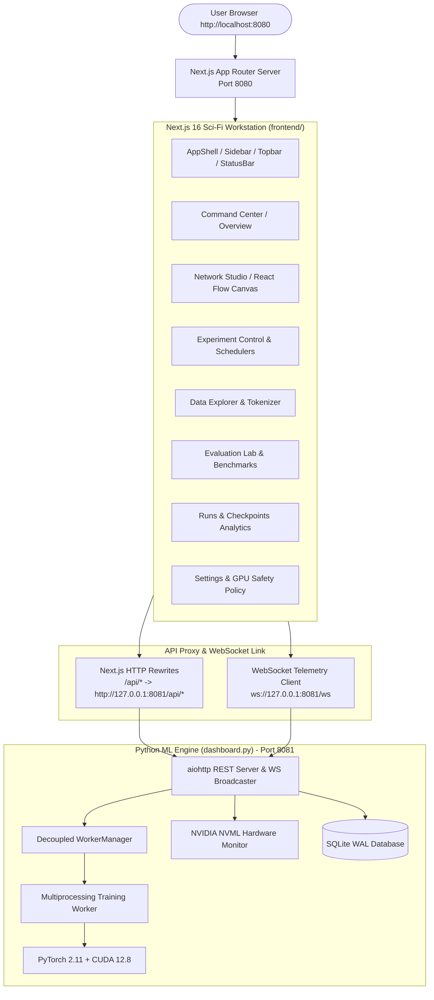

# RoCanon-48.5M — Next.js Sci-Fi Neural Research Workstation v2
## Frontend Modernization & Migration Architecture Report

### Executive Summary
The frontend of the **RoCanon-48.5M Training Platform** has been fully modernized from a monolithic inline HTML template into an advanced, futuristic neural research workstation built with **Next.js 16 (App Router)**, **React 19**, **TypeScript**, **Tailwind CSS**, **@xyflow/react (React Flow)**, **Chart.js**, and **Lucide Icons**.

The decoupled Python backend (`aiohttp`, PyTorch CUDA, NVML telemetry, multiprocessing worker, SQLite WAL persistence) is 100% preserved. The application maintains full backward compatibility and operates at the standard browser address: `http://localhost:8080`.

---

### 1. Technology Architecture



---

### 2. Port Configuration & Routing

| Service | Host | Port | Responsibility |
| :--- | :--- | :--- | :--- |
| **Next.js Workstation** | `127.0.0.1` | **`8080`** | Primary user interface, App Router, SSR/Static pages, styling |
| **Python ML Backend** | `127.0.0.1` | **`8081`** | REST API endpoints, WebSocket broadcaster, worker management |
| **API Proxy** | `http://localhost:8080/api/*` | — | Proxied via Next.js `rewrites()` in `next.config.ts` |
| **WebSocket Telemetry** | `ws://127.0.0.1:8081/ws` | `8081` | Real-time bi-directional telemetry and event streaming |

---

### 3. Sci-Fi Visual Design System

The visual design system combines the aesthetic of a futuristic scientific research console with the utility of a high-performance machine learning IDE:

- **Color Palette**:
  - Background: Deep midnight navy (`#050811`), dark graphite (`#090e1a`)
  - Accent Primaries: Electric cyan (`#00f0ff`), Ice blue (`#38bdf8`)
  - Accent Secondaries: Controlled violet (`#818cf8`), Deep indigo (`#6366f1`)
  - Status Indicators: Healthy emerald (`#10b981`), Warning amber (`#f59e0b`), Critical rose (`#ef4444`)
- **Visual Texture**:
  - Subtle technical grid overlay (`sci-fi-grid`)
  - Glassmorphic panels with backdrop blur (`glass-panel`)
  - Cyan luminous corner highlights and pulse animations
  - Monospaced numerals (`font-mono-num`) for all numerical telemetry (steps, loss, clock rates, VRAM)
  - Quick action launcher with `Ctrl+K` command palette

---

### 4. Core Features & Module Parity

#### 1. Overview (Command Center)
- **Real-Time Telemetry Bar**: Shows active session status, worker state, and instant actions (Pause, Resume, Checkpoint, Validate, Halt).
- **8 KPI Metric Cards**: Train loss, Val loss, Step count, Cumulative tokens seen, Throughput (tok/s), Learning rate, L2 Grad norm, Step latency (ms).
- **Interactive Dynamics Plot**: Real-time Chart.js tracking training loss and periodic validation loss.
- **Hardware Telemetry Card**: Real-time VRAM allocation bar, GPU temp, Power draw, Core and Memory clocks via NVML.
- **Dynamic LR Scaling Slider**: Real-time multiplier scaling without interrupting the worker.
- **Activity & Alerts Feed**: Live stream of worker events and hardware warnings.

#### 2. Network Studio (Interactive Architecture Designer)
- **Interactive React Flow Canvas**: Node-based graph construction supporting zoom, pan, mini-map, auto-layout, and drag-and-drop.
- **Grouped Component Palette**:
  - *Embedding*: Token Embedding, Positional Encoding, Linear Projection
  - *Attention*: Multi-Head Attention, Grouped Query Attention (GQA 8:2), Multi-Query Attention (MQA), Causal Attention, Cross Attention
  - *Feed Forward*: SwiGLU FFN, Dense MLP, GELU, SiLU
  - *Normalization*: RMSNorm, LayerNorm, Sequence BatchNorm1d
  - *Structural*: Residual Block, Conv1D / Depthwise, Dropout
- **Analytical Metrics Console**: Computes exact total parameters, trainable parameters, model memory (MB), and training VRAM with 6GB RTX 3060 Laptop GPU compliance badge.
- **Preflight Architecture Validation**: Direct API integration with `ArchitectureValidator.run_preflight_check()`.
- **Registry Actions**: Save to registry, clone, delete, and load standard presets.

#### 3. Training & Experiment Control
- **Model & Task Configuration**: Select registered architecture, dataset (built-in or uploaded), and task type (Causal LM, Masked LM, Classification, Regression).
- **Dual Optimizer Selection**: Supports Muon + AdamW, AdamW Standard, or SGD.
- **Analytical Schedule Preview**: Live curve visualizer for Warmup-Stable-Decay (WSD), Cosine, Linear, or Constant schedules calling `/api/scheduler/curve`.
- **Hardware Budget Enforcement**: Configurable micro-batch size, gradient accumulation steps, sequence length, and gradient clipping norm.
- **Early Stopping Control**: Configurable patience and grace period (`min_steps=500`), disabled by default for long pre-training runs.

#### 4. Datasets & Data Explorer
- **Drag-and-Drop Uploader**: Direct upload supporting `.txt`, `.jsonl`, `.json` up to 500MB with automated tokenization caching.
- **Dataset Library**: Searchable data table with dataset source, total tokens, size in MB, and inspection modal.
- **Tokenizer Inspector**: Interactive BPE tokenizer inspector testing Romanian text, displaying token count, compression ratio, and colorized token badges.

#### 5. Evaluation Lab & Inference Engine
- **Single Generation**: Configurable sampling sliders (Max new tokens, Temperature, Top-P, Top-K, Repetition penalty) with tokens/sec speed, generation time, and device reporting.
- **GPU Single-Owner Arbitration**: Automatically routes inference to CPU when training worker is active, preventing GPU OOM.
- **Side-by-Side Checkpoint Comparison**: Evaluates identical prompts across 2+ checkpoints simultaneously.
- **Automated Benchmark Suite**: Triggers benchmark suite and displays historical scores table.

#### 6. Runs, Checkpoints & Analytics
- **Searchable Run History**: View all experiments, status, total steps, tokens, best validation loss, and start times.
- **Historical Loss Dynamics**: Selecting any historical run loads its entire loss and learning rate trajectory into interactive charts.
- **Checkpoint Manager**: List all `.pt` checkpoints on disk, inspect metadata, delete with confirmation, or load directly into Evaluation Lab.

#### 7. System Settings & GPU Safety Policy
- **Hardware Policy**: Set VRAM alarm ceiling (default 5,000 MB for 6GB RTX 3060 Laptop), thermal warning threshold (°C), and NVML polling interval.
- **Checkpoint Retention Policy**: Configurable rolling window (keeps max 4 step checkpoints + best model).
- **SQLite Persistence**: Settings persist directly to SQLite WAL database across application restarts.

---

### 5. Startup & Operational Scripts

To launch the complete platform (Backend on 8081 + Next.js on 8080):

#### Windows Batch Launcher (`run_studio.bat`):
```cmd
run_studio.bat
```

#### Manual Development Startup:
```bash
# Terminal 1 - Python Backend
.venv\Scripts\python.exe dashboard.py --port 8081

# Terminal 2 - Next.js Workstation
cd frontend
npm run dev -- -p 8080
```

#### Manual Production Startup:
```bash
# Terminal 1 - Python Backend
.venv\Scripts\python.exe dashboard.py --port 8081

# Terminal 2 - Next.js Workstation
cd frontend
npm run build
npm run start -- -p 8080
```

---

### 6. Verification & Test Suite Summary

- **Next.js Production Build**:
  - `npm run build`: **0 errors**. All 7 routes prerendered cleanly (`/`, `/studio`, `/training`, `/datasets`, `/evaluation`, `/runs`, `/settings`).
- **Backend API Integration Suite (`tests/test_frontend_integration.py`)**:
  - **9 / 9 passed** in 5.15s. All REST API endpoints and WebSocket telemetry handshakes verified.
- **Mandatory E2E Acceptance Suite (`tests/e2e/test_mandatory_acceptance.py`)**:
  - **5 / 5 passed** in 6.48s. Checkpoint continuity, custom model training, dataset integrity, and full architecture lifecycle verified.
- **Full PyTorch Repository Test Suite (`pytest tests/`)**:
  - **239 / 239 passed** in 34.17s. Zero regressions across the entire platform.
