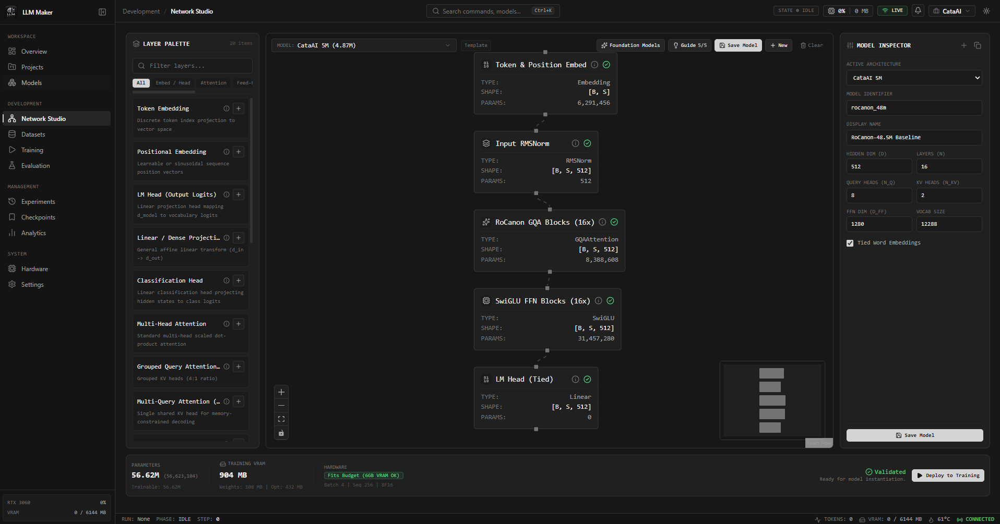
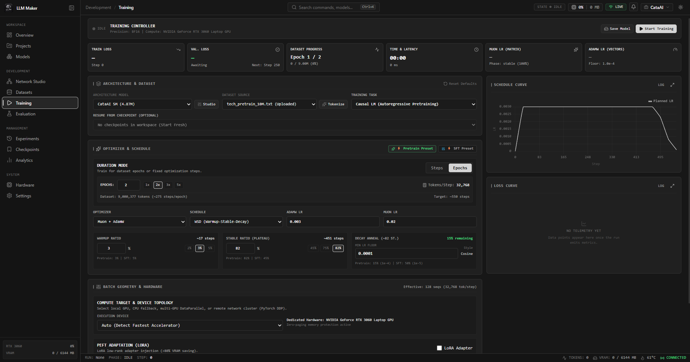
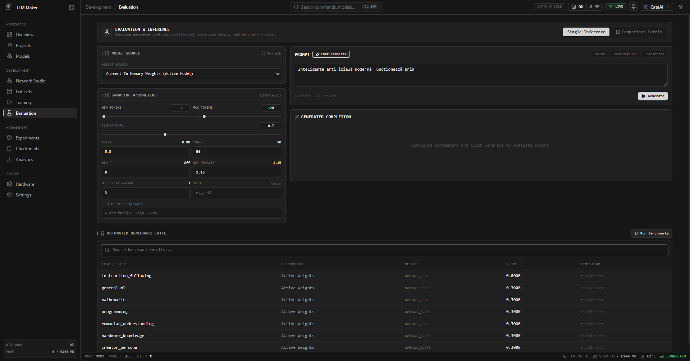
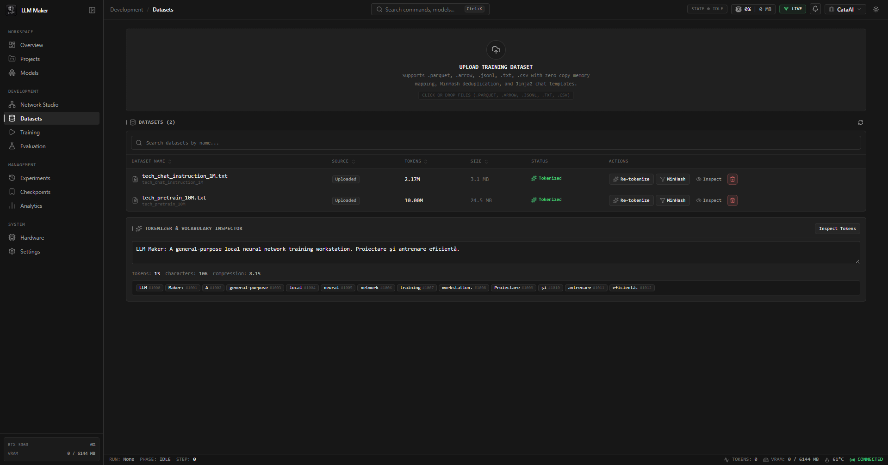

# LLM Maker 🧠⚡

> **High-Performance Local Neural Architecture Studio & Distributed LLM Training Platform**

[](https://pytorch.org)
[](https://developer.nvidia.com/cuda-toolkit)
[](https://tauri.app)
[](https://rust-lang.org)
[](https://nextjs.org)
[](LICENSE)
[]()

**LLM Maker** is an end-to-end, local-first research platform designed to democratize pretraining, post-training alignment, and architectural experimentation for Large Language Models. Built for consumer hardware (from 6GB VRAM laptop GPUs up to multi-node distributed clusters), it combines a **native desktop workstation** (Rust + Tauri 2.0), **visual node-based neural architecture studio**, **WDDM-aware zero-paging VRAM protection**, **hybrid Muon + AdamW optimizers**, **percentage-based WSD scheduling**, and **Hugging Face Hub foundation imports**.

---

## 📸 Platform Tour

### 1. Visual Neural Architecture Studio

Design, inspect, and benchmark custom transformer and hybrid architectures on a node-based visual canvas. Validates tensor shapes and calculates memory headroom in real time before training.



---

### 2. Training Controller & Dynamic WSD Engine

Real-time loss telemetry, percentage-based Warmup-Stable-Decay scheduling curve visualization, on-the-fly learning rate steering, and zero-paging VRAM protection.



---

### 3. Evaluation & Interactive Inference Lab

Test model checkpoints with full sampling controls (temperature, top-p, top-k, min-p, min new tokens, repetition penalties, chat templates), multi-model comparison matrix, and automated benchmark suites.



---

### 4. Dataset Manager & Binary Memmap Tokenization

Inspect, curate, and tokenize datasets into high-speed binary memmaps (`.bin` + `.meta.json`). Guarantees zero runtime tokenization overhead and constant memory consumption.



---

## 🚀 Key Capabilities

### 1. Native Desktop Workstation (Rust + Tauri 2.0)

- **Zero Browser Overhead**: Ships as an optimized native executable (`llm-maker.exe`) communicating directly with a decoupled Python ML worker via high-speed asynchronous OS IPC.
- **0 MB Idle VRAM**: When not actively training, PyTorch CUDA memory is cleanly released back to the operating system, keeping GPU idle consumption at 0 MB.
- **Resilient Process Supervisor**: Continuous stderr streaming to `tauri_debug.log` prevents OS pipe buffer exhaustion and captures worker telemetry without deadlocks.
- **Dual Mode**: Run natively on the desktop or launch as a shared web studio over your LAN.

### 2. Flexible Compute Targets: Single GPU, CPU, Multi-GPU & Cluster DDP

LLM Maker dynamically inspects your hardware topology via NVML and provides 1-click execution target selection:

- **Single GPU (`cuda:0` / `cuda:1`)**: Hardware-accelerated training with active WDDM paging cliff protection (restricting peak allocations beneath Windows OS limits to prevent throughput collapse).
- **CPU Fallback (`cpu`)**: Pure CPU execution utilizing host RAM for smoke testing and debugging without a dedicated GPU.
- **Multi-GPU Parallel (`multi_gpu`)**: Automatically wraps models across all local GPUs on the machine via PyTorch DataParallel with balanced tensor distribution.
- **Distributed Node Cluster (`cluster` / PyTorch DDP)**:
  - Automatically detects cluster topology from environment variables (`MASTER_ADDR`, `MASTER_PORT`, `WORLD_SIZE`, `RANK`) or explicit UI input.
  - Coordinates multi-node training across networked machines via TCP/IP sockets with NCCL (CUDA) or Gloo (CPU) backends.

### 3. Task-Specific Optimal Hyperparameter Presets

Different LLM training tasks require fundamentally different learning dynamics. Selecting any task in LLM Maker immediately applies verified AdamW, Muon, learning rate floor, warmup, and stable percentages:

| Task Preset                           | Optimizer        | AdamW Peak LR      | Muon Peak LR       | Min LR Floor        | Warmup % | Stable % | Decay % | Rationale                                                                        |
| :------------------------------------ | :--------------- | :----------------- | :----------------- | :------------------ | :------- | :------- | :------ | :------------------------------------------------------------------------------- |
| **Pretrain Causal LM**          | `Muon + AdamW` | `0.003` (3e-3)   | `0.02` (2e-2)    | `0.0001` (1e-4)   | `3%`   | `82%`  | `15%` | Long stable plateau maximizes raw token throughput & representation formation    |
| **Instruction SFT**             | `Muon + AdamW` | `0.0003` (3e-4)  | `0.005` (5e-3)   | `0.00001` (1e-5)  | `5%`   | `45%`  | `50%` | Gentle steering preserves base capabilities and prevents catastrophic forgetting |
| **SimPO / ORPO**                | `Muon + AdamW` | `0.00005` (5e-5) | `0.001` (1e-3)   | `0.000005` (5e-6) | `10%`  | `30%`  | `60%` | Reference-free preference optimization requires conservative step sizes          |
| **GRPO**                        | `Muon + AdamW` | `0.00002` (2e-5) | `0.0005` (5e-4)  | `0.000001` (1e-6) | `10%`  | `40%`  | `50%` | Group relative policy optimization with tight reward clipping bounds             |
| **DPO**                         | `Muon + AdamW` | `0.00002` (2e-5) | `0.0005` (5e-4)  | `0.000002` (2e-6) | `10%`  | `20%`  | `70%` | Implicit reward model alignment benefits from extended decay annealing           |
| **Masked LM**                   | `Muon + AdamW` | `0.002` (2e-3)   | `0.015` (1.5e-2) | `0.0001` (1e-4)   | `5%`   | `75%`  | `20%` | Bidirectional representation learning                                            |
| **Classification / Regression** | `Muon + AdamW` | `0.0001` (1e-4)  | `0.002` (2e-3)   | `0.00001` (1e-5)  | `10%`  | `40%`  | `50%` | Downstream head convergence                                                      |

### 4. Percentage-Based WSD (Warmup-Stable-Decay) Scheduling

Unlike rigid step-count schedulers, LLM Maker schedules training by percentage ratios (`warmup_steps_pct` and `stable_steps_pct`). When your planned steps or epoch target changes, warmup, plateau, and decay automatically scale proportionally:

- **Warmup Phase ($0 \to \text{Warmup}$)**: Linear increase from min LR floor to peak LR.
- **Stable Plateau ($\text{Warmup} \to \text{Stable}$)**: Constant maximum learning rate where the bulk of token representations are learned.
- **Decay Phase ($\text{Stable} \to \text{Total}$)**: Cosine annealing condensing representations down to the minimum learning rate floor.

### 5. Hugging Face Pretrained Model Import

- Load pretrained foundation models directly from the Hugging Face Hub (e.g. `meta-llama/Llama-3.2-1B`, `Qwen/Qwen2.5-0.5B`, `mistralai/Mistral-7B`, `gpt2`).
- 1-click import pulls model configuration, tokenizer vocabularies, and safetensors weights.
- Converts Hub models into native LLM Maker JSON architecture configs (`networks/registry/`) ready for SFT, PEFT/LoRA, or architecture surgery in the visual builder.

### 6. Zero-Copy Binary Memmap Tokenization

- High-throughput multi-threaded tokenization converts raw text or JSONL datasets into optimized `uint16` binary memmaps (`.bin` + `.meta.json`).
- Pre-tokenized binaries are cached on disk and memory-mapped directly into PyTorch worker processes with zero runtime re-tokenization overhead.
- Constant RAM footprint regardless of whether the dataset contains 1M or 100M tokens.

### 7. Visual Neural Architecture Studio

- **Drag-and-Drop Canvas**: Visually compose custom transformer and hybrid architectures with strict tensor dimension contracts.
- **Modular Blocks**: MHA, GQA, MQA, RoPE (Rotary Position Embeddings), RMSNorm, LayerNorm, SwiGLU, GeLU, and MoE routing.
- **Instant Parameter & Memory Estimator**: Real-time analytical VRAM breakdown (weights, optimizer states, activations, KV-cache) before spending a single GPU second.

---

## 💻 Hardware Requirements & Batches

| Hardware Tier                                                   | Recommended Model Size  | Context Length      | Batch Configuration                 | Compute Mode                             |
| :-------------------------------------------------------------- | :---------------------- | :------------------ | :---------------------------------- | :--------------------------------------- |
| **Consumer (6 GB VRAM)***(e.g. RTX 3060 / 4060 Laptop)* | 5M – 48.5M parameters  | 256 – 1024 tokens  | Micro-batch: 4–8Accumulation: 4–8 | Single GPU (`cuda:0`) with Zero-Paging |
| **Mid-range (8 – 12 GB VRAM)***(e.g. RTX 3080 / 4070)* | 50M – 130M parameters  | 1024 – 2048 tokens | Micro-batch: 8–16Accumulation: 4   | Single GPU / Multi-GPU                   |
| **High-end (16 – 24 GB VRAM)***(e.g. RTX 3090 / 4090)* | 150M – 500M parameters | 2048 – 4096 tokens | Micro-batch: 16–32Accumulation: 4  | Single GPU / Multi-GPU                   |
| **Enterprise / Cluster***(e.g. Multi-node A100 / H100)* | 1B – 7B+ parameters    | 4096 – 8192 tokens | High-throughput distributed         | Distributed Cluster (PyTorch DDP)        |

---

## ⚡ Quickstart

### Launch Desktop Application (Windows Native)

```cmd
REM 1. One-time setup: detects the GPU and installs the matching CUDA/CPU PyTorch
setup.bat

REM 2. Launch Native Desktop App
run_desktop.bat
```

*(Or launch `llm-maker.exe` directly from the project root).*

### Launch Web Studio Mode (Cross-Platform)

```bash
# Windows
run_studio.bat

# Linux / macOS
chmod +x setup.sh run_studio.sh
./run_studio.sh
```

Open **[http://localhost:8080](http://localhost:8080)** in your browser. All requests to the headless Python backend (port 8081) automatically synchronize with the studio interface.

---

## 🧪 Running the Test Suite

LLM Maker includes 270+ automated tests verifying neural layer arithmetic, tokenizer parity, dataset pipelines, VRAM estimators, checkpoint resumption, and IPC commands:

```bash
# Run the complete test suite
pytest

# Run specific modules
pytest tests/unit/test_architecture.py
pytest tests/unit/test_optimizer.py
pytest tests/e2e/test_product_generalization.py
```

---

## 🌐 Website

The public site lives in `website/` and is a separate static Next.js export, so its
dependencies and build do not affect the desktop app:

```bash
cd website
npm ci
npm run dev      # http://localhost:3000
npm run build    # static output in website/out
```

`.github/workflows/pages.yml` deploys `website/out` to GitHub Pages on a push to
`main` or `experimental` that touches the site. **The repository Pages source must
be "GitHub Actions"** (Settings -> Pages -> Build and deployment -> Source). If it
is left on "Deploy from a branch", GitHub ignores the workflow and renders
`README.md` through Jekyll. For a project site the workflow builds with
`NEXT_PUBLIC_BASE_PATH=/<repo>`; a user site or custom domain builds with an empty
base path. Delete any duplicate Pages workflow; `pages.yml` is the only deploy
workflow.

---

## 🏛 Architecture & Project Layout

```
llm-maker/
├── screenshots/               # Application screenshots for platform documentation
│   ├── network_studio.png     # Visual architecture builder canvas
│   ├── training.png           # Training controller & live WSD curve
│   ├── evaluation.png         # Interactive inference & benchmark suite
│   └── datasets.png           # Dataset management & tokenization lab
│
├── src-tauri/                 # Rust Native Desktop Host (Tauri 2.0)
│   ├── src/
│   │   ├── main.rs            # Desktop window lifecycle
│   │   ├── lib.rs             # Tauri application entrypoint & command handlers
│   │   ├── commands.rs        # IPC command bridges & hardware telemetry
│   │   ├── worker.rs          # Decoupled Python ML worker supervisor
│   │   └── database.rs        # SQLite query adapter for desktop
│   └── Cargo.toml             # Rust package manifest
│
├── src/                       # Core Python ML Engine
│   ├── checkpoints/           # Atomic checkpointing, save/load & metadata
│   ├── dashboard/             # aiohttp async REST & control plane
│   ├── datasets/              # Binary memmap tokenization & streaming loaders
│   ├── db/                    # SQLite WAL persistence for metrics & runs
│   ├── eval/                  # Real-time inference engine & benchmark lab
│   ├── model/                 # Baseline RoCanon architectures & layers
│   ├── networks/              # Visual Builder factory & MemoryEstimator
│   ├── optimizers/            # Hybrid Muon + AdamW implementations
│   ├── telemetry/             # NVML hardware monitoring & compute topology
│   ├── training/              # Task adapters (Pretrain, SFT, SimPO, DPO, DDP)
│   └── worker/                # Decoupled standalone ML worker process
│
├── frontend/                  # Next.js 16 / React 19 Studio UI
│   ├── src/
│   │   ├── components/        # High-contrast UI components & visual canvas
│   │   ├── features/          # Builder, Training, Datasets, Runs, Inference
│   │   └── services/api.ts    # Dual-mode API adapter (Tauri IPC + HTTP/WS)
│   └── package.json
│
├── website/                   # Static marketing/audit site (Next.js export)
│   ├── app/                   # Single-page dossier & styles
│   └── public/                # Screenshots and static assets
│
├── networks/registry/         # Exported model architecture configs (JSON)
├── datasets/                  # Datasets & pre-tokenized memmap binaries (.bin/.meta.json)
└── tests/                     # 270+ unit and end-to-end tests
```

---

## 📄 License

This project is open-source under the Apache License 2.0.
